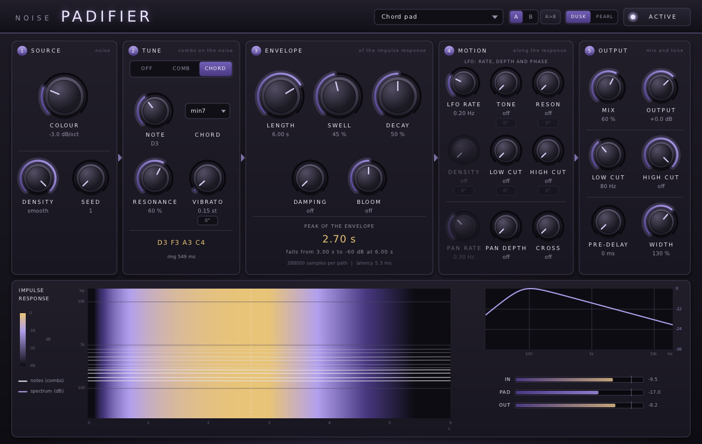
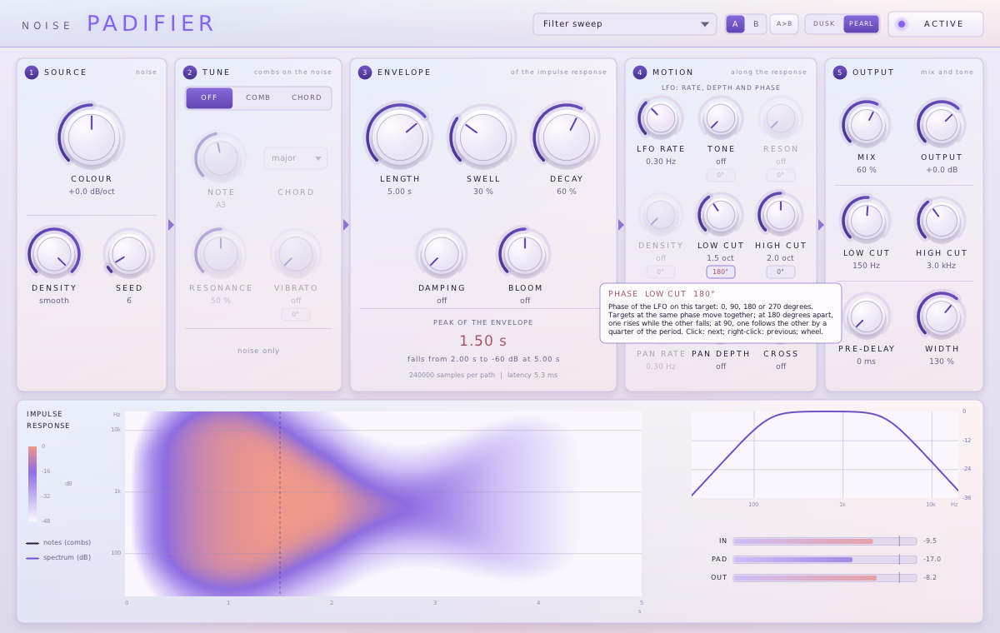

# Noise Padifier

A convolution pad effect for VST3, CLAP and LV2: the input is convolved with **shaped noise**
(0.1 to 30 s), so that every note and every attack is smeared into a pad. The timbre of the source
stays (its harmonics keep their place), its shape in time is replaced by the response, and the
noise can be coloured, tuned, shaped in time and frequency and moved in stereo.



## Features

- **Source**: **Colour** from brown (-6 dB/octave) through pink and white to violet (+6), **Density**
  from smooth noise down to sparse "velvet" noise (a cloud of grains or echoes), **Seed** (the same
  seed always gives the same response, on every computer).
- **Tune**: a comb filter on a **note**, or one comb per note of a **chord** (major, minor, sus,
  sevenths, octaves...), with **resonance** and **vibrato**: the pad takes the note or the chord.
- **Envelope**: **Length**, **Swell** (rise; 100 % gives a reverse swell), **Decay** (part of the length
  taken by the fall to -60 dB; 0 % gives a held pad), **Damping** (the highs die sooner) and **Bloom** (the peak moves with
  frequency: the pad opens up or warms up).
- **Motion along the response**: an **LFO** on the pitch of the combs, the colour, the resonance,
  the density and swept **low cut** and **high cut** filters, each target with its own **phase**
  (0, 90, 180 or 270 degrees), a stereo **pan** motion, and **Cross**: true stereo, each input also reaching the other side.
- All these treatments are computed once, when the response is built (in a worker thread; the new
  response is crossfaded in without a click), and **cost nothing during playback**.
- **Low-latency, low-CPU convolution**: partitioned FFT convolution in three stages of growing
  blocks (pffft), work spread evenly over the blocks, no allocation in the audio thread; 256
  samples of latency, reported to the host. About 2.2 % of one core at 48 kHz with a 30 s response
  (3.9 % with Cross).
- **Pre-delay**, **Low cut** and **High cut** on the pad (12 dB/octave), **Width**, **Mix** at
  constant power, **Output**; unit-energy responses: a broadband input keeps its level in the pad.
- **Interface**: five sections in the order of the signal, a **time-frequency map** of the
  response (envelope, damping, bloom, notes of the combs with their vibrato), the spectrum of
  the pad and meters; knobs without effect are drawn faint.
- **Presets**: 13 factory presets and your own (save, replace, delete), shared by all projects.
- **A/B comparison** saved with the project; dark (Dusk) and light, opalescent (Pearl) themes; tooltips
  everywhere; keyboard entry of values (right-click a knob); resizable HiDPI interface.
- Bypass declared to the host (delayed dry signal: constant latency), smoothed controls, no
  denormal slowdown.



## Formats

| Platform | Formats |
|---|---|
| Windows 64-bit | VST3, CLAP (installer included) |
| Linux x86-64 | VST3, CLAP, LV2 |

## Installation

**Windows**: run `Noise-Padifier-1.2.0-setup.exe` (VST3, optional CLAP and user manuals).
Manually: copy the `noise_padifier.vst3` folder to `C:\Program Files\Common Files\VST3\` and
`noise_padifier.clap` to `C:\Program Files\Common Files\CLAP\`.

**Linux**: copy `noise_padifier.vst3` to `~/.vst3/`, `noise_padifier.clap` to `~/.clap/` or
`noise_padifier.lv2` to `~/.lv2/`.

## Documentation

- **User manual**: [`doc/manual.pdf`](doc/manual.pdf) (English), [`doc/manuel.pdf`](doc/manuel.pdf)
  (French): every setting, the presets, tips, and a description of the algorithm (the steps that
  make the responses, partitioned convolution, crossfade of a new response, mix law, measured
  cost), with figures computed from the plugin's own code (`doc/figures.py`; impulse responses
  through `tools/ir.cpp`).
- Developer notes (French): [`LISEZMOI.md`](LISEZMOI.md).

## Building

From Linux with MinGW-w64 (`-posix`), git, and optionally NSIS: `./build.sh` clones DPF at the
tested commit, applies `patches/`, runs the tests, and builds Windows and Linux binaries and the
installer into `bin/` (`BENCH=1 ./build.sh` also prints the cost of the DSP).
The manuals need `gcc`, `g++`, `python3-numpy`, `python3-matplotlib` and `pdflatex`
(`figures.py` writes the figures of both languages):

```sh
cd doc && python3 figures.py
for m in manual manuel; do pdflatex $m.tex && pdflatex $m.tex && pdflatex $m.tex; done
```

## Tests

`tests/test_ir.cpp` measures each treatment on the responses made by the plugin against its law
(colour within 0.73 dB per octave, comb and chord peaks, vibrato within 0.4 Hz, damping within
0.8 dB, bloom within 0.15 s, LFO on the colour, the resonance, the density and the filters with
their phases, pan, cross). `tests/test_dsp.cpp`,
built twice (strict, and with the plugin's `-O3 -ffast-math`): convolution against a direct
double-precision convolution (within 4.4e-7 of the peak, 48 to 192 kHz, odd host block sizes; crossed
responses within 3.5e-7), exact crossfade between two responses, and the whole plugin (latency,
bit-exact mix 0 % and bypass, convolution with the responses of the settings,
exact pre-delay, filters, width, presets, FPU state). Also `tests/test_prefs.cpp` and
`tests/test_user_presets.cpp`. Steinberg's VST3 validator passes 47/47 on the Linux and Windows
builds.

## Licence

GPL-3.0-or-later (`COPYING`). `plugin/pffft/` holds the unmodified pffft by Julien Pommier
(FFTPACK licence, BSD-like; `PROVENANCE.txt`). The binaries also contain DPF (ISC), NanoVG (zlib),
pugl (ISC), the CLAP headers (MIT) and the DejaVu Sans font: their notices are in
`THIRD_PARTY_LICENSES.txt`, shipped with every download.
